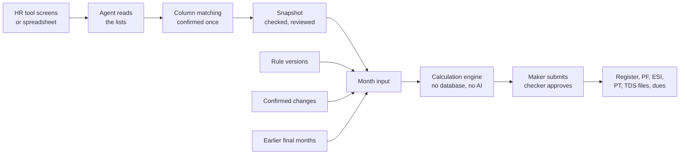
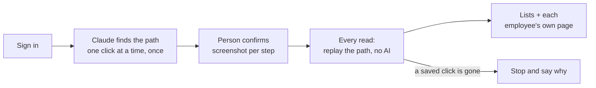

# Payroll Compliance

Indian payroll that reads HR data from any HR tool, explains every number, and needs two people to sign off each month.

An agent signs in to the HR tool (Horilla, a Keka-like tool, or any other) and finds the employee, salary and leave
lists by itself. A person confirms what it found. A pure calculation engine then works out salary, unpaid leave,
arrears, PF, ESI, professional tax and TDS, with a formula, a reason and the rule version behind every amount. A
finance team employee prepares the month, the finance head approves it, and the payment files and government dues
follow.

## What it does

| Area | What happens |
| --- | --- |
| **HR data** | The agent reads the HR tool's screens like a person, or the team uploads Excel/CSV files. Both end as the same checked snapshot. |
| **Finding the data** | Claude finds each list once, one click at a time if it sits behind menus and tabs. Every later read replays the confirmed clicks with no AI. |
| **Complete data** | A missing joining date, work state, gender or salary blocks the data before any month can use it. |
| **Calculation** | Salary per day, unpaid leave, part months, arrears, one-time pay, PF (with the Labour Codes 50% rule), ESI, PT by state, TDS over the financial year. |
| **Changes** | Typed in plain English ("Pay Priya a ₹10,000 bonus") or entered in a form. AI proposes, code checks, a person confirms. |
| **Approval** | Maker prepares, a different person (checker) approves. Each month runs as a durable Temporal workflow. |
| **Output** | Payroll register and PF, ESI, PT and TDS files, all reconciled to the register, plus government dues tracked until paid. |
| **Rules** | Government rules and company settings are dated versions. A change is a new version; paid months never change. |

## Quick start

Needs Python 3.10+, Node 18+ and the Temporal CLI (`brew install temporal`).

```bash
./scripts/start.sh        # installs, builds, seeds the demo company, starts everything
./scripts/stop.sh         # stops everything (all state is kept in var/)
```

| Service | Address | Login |
| --- | --- | --- |
| Payroll app | http://localhost:8080 | `maker` / `maker123` (prepares) · `checker` / `checker123` (approves) |
| Demo HR tool | http://localhost:8100 | `hr.admin` / `demo123` |
| Keka-like HR tool | http://localhost:8101 | `hr.admin` / `demo123` (lists behind menus and tabs) |
| Temporal UI | http://localhost:8233 | — |

Horilla, with 85 made-up employees of Brickline Design Co.:

```bash
./scripts/horilla.sh setup && ./scripts/horilla.sh start     # http://localhost:8000, admin / admin
./scripts/horilla.sh stage october                           # HR data up to the end of October
```

## How it works



### The agent



- Claude only picks the next click, and only from what is on the screen. Plain code decides when the list is found.
- It opens one employee's page, clicks each tab, and keeps the tabs that add fields such as joining date and gender.
- It never clicks save, delete, approve, submit or edit, and never leaves the HR tool's own site.
- If the screens change, the read stops with the reason and a person runs **Find screens again**.

### The calculation engine

One employee's month runs through 13 steps in payslip order: regular pay, arrears, one-time items, gross, PF, ESI,
professional tax, TDS, other deductions, net pay, company PF, company ESI and cost to company.

- **Rules are data.** Each rule is picked as of the 1st of the month. What-if values and a month's own day count
  sit on top of stored versions, which sit on top of built-in defaults.
- **Salary by day.** A raise during the month pays each part at its own salary, and days before joining or after
  leaving use the nearest salary in force during employment. For records effective on the same date, the latest
  recorded correction known at calculation time wins.
- **Arrears by themselves.** Each earlier final month is worked out again with what is known now and its own rules;
  the difference from cash and PF already paid is paid or recovered, including the employer's EPS and EPF split.
- **TDS projection.** The forecast uses the earnings and rounding rules for each remaining month and accounts for
  known salary changes and exit dates. It credits tax previously withheld before collecting tax on one-time pay.
- **ESI coverage.** The calculation uses recorded coverage from the same contribution period and the employee
  daily wage exemption in the applicable rule version.
- **Repeatable.** Input and result are stored with a SHA-256 fingerprint. Before approval the engine runs again on
  the stored input and must give the identical result.

## Where AI is used, and where it is not

| AI may | AI never |
| --- | --- |
| Find an HR tool's screens | Work out any amount |
| Read a screen that has no table (values must be on the screen) | Pick which rule applies |
| Suggest which column means which payroll field | Approve, finalise or change a payroll |
| Turn a typed instruction into a proposed change | Act without a person confirming |
| Explain what changed since last month | Click anything that changes data in the HR tool |

Every AI answer is stored and shown in the **AI log**, and the same question is never asked twice. A company can
switch AI off: keyword matching and the known HR tool profiles then do the same jobs.

AI providers (`AI_PROVIDER` in `.env`): `anthropic` (Claude API, needs `ANTHROPIC_API_KEY`), `cli` (Claude Code,
development only) or `off`.

## Project layout

```
backend/
  payroll_engine/        the calculation: earnings, arrears, pf, professional_tax, tds, steps, policies
  payroll/features/      Django features: hr_data (agent, ingestion), payroll_runs (months, workflow),
                         rules, dues, onboarding, companies, accounts, ai
  tests/                 engine, answer sheets, agent, workflow, API
frontend/src/features/   the screens, one folder per feature
mock_hrms/               the demo HR tool (flat and Keka-like layouts)
integrations/horilla/    the Horilla profile and its demo data
data/                    demo companies and government rule values
answer_sheets/           expected results the tests check against
```

## Tests

```bash
make test       # every test, including the answer sheets
make answers    # report: which numbers match the answer sheets
```

The answer sheets compare every amount with an independent reference calculation that does not import the engine.
The live Horilla import test runs only while Horilla is up; otherwise it is skipped.

## Not supported yet

- Old tax regime, tax declarations and perquisites (new regime only).
- ESI coverage before the first recorded payroll, EPS eligibility by age, EDLI and admin charges, gratuity and bonus acts.
- Infinite scroll, CAPTCHA and two-factor logins in HR tools.
- Writing changes back into the HR tool.
- HR tool passwords are stored in the database; use a secret store in production.

More detail: [GUIDE.md](GUIDE.md).
